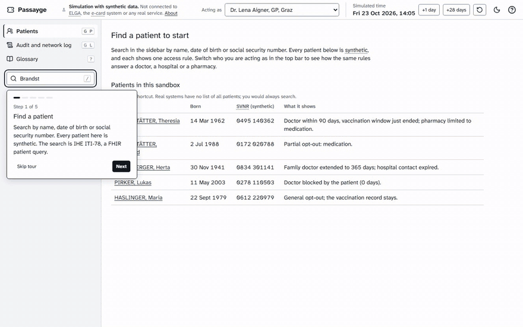
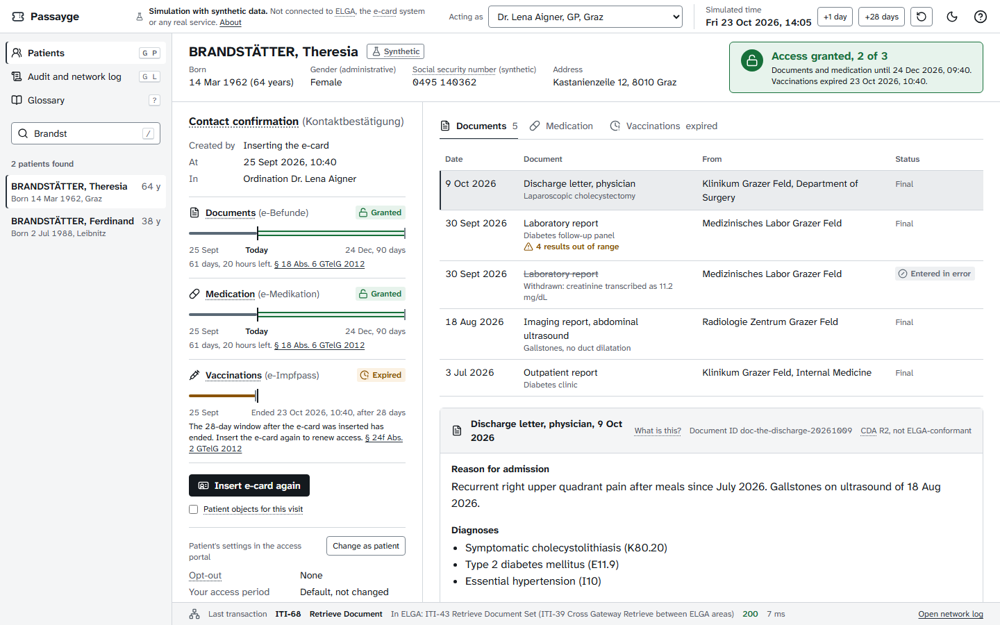
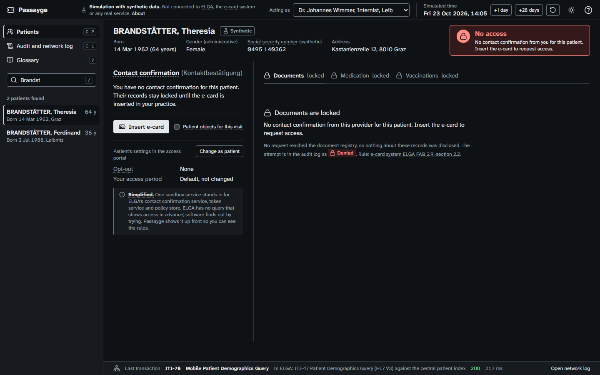
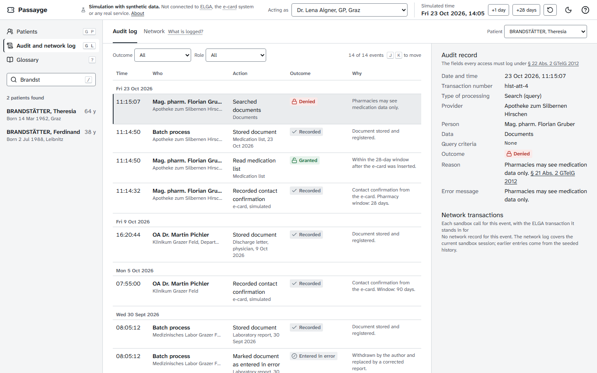
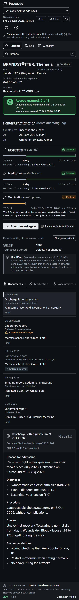

# Passayge

Say it like "passage". A sandbox that shows how patient data moves in an ELGA-style health data exchange: finding a patient, the e-card contact confirmation that opens their records for a limited time, reading documents, and an audit log of every access.

**Unofficial simulation. Not affiliated with or endorsed by ELGA GmbH, the Dachverband der österreichischen Sozialversicherungsträger or HL7 International.** Passayge is not connected to ELGA, the e-card system or any real service. Every person, provider and record in it is synthetic.



## What it shows

- **Who may look, and for how long.** Inserting the e-card records a contact confirmation (Kontaktbestätigung). Doctors and hospitals may then open the records for 90 days, pharmacies see medication only and for 28 days, and the vaccination record (e-Impfpass) allows 28 days for everyone. Patients can extend a trusted doctor or pharmacy to 365 days, block a provider, or opt out.
- **What happens on the wire.** ELGA-style flows rebuilt on IHE FHIR profiles. Every call is listed with its IHE transaction and, next to it, the ELGA transaction it stands in for.
- **What gets logged.** Every search, opening, refusal and expiry becomes an audit record with the fields Austrian law lists for ELGA access logs.

Five synthetic patients each show one rule. Switch who you are acting as (a GP, an internist who has never seen the patient, a hospital, a pharmacy) and move the simulated clock to watch windows close.

| | |
|---|---|
|  |  |
|  |  |

## Run it

You need Docker.

```bash
git clone https://github.com/Henrycarto/passayge.git
cd passayge
docker compose up --build
```

Open http://localhost:8080. The first start takes two to three minutes while HAPI FHIR loads the HL7 Austria profiles; the gateway seeds the synthetic data once HAPI is ready. A short tour opens on the first visit and can be reopened from the ? button.

Development, tests and how to contribute: [CONTRIBUTING.md](CONTRIBUTING.md).

## How it is built

```
Browser (React)  ->  Gateway (Node, Fastify)  ->  HAPI FHIR R4 with HL7 Austria FHIR Core 2.0.0
                     access rules, simulated clock,
                     network log, audit records
```

| Sandbox call | IHE transaction | In ELGA |
|---|---|---|
| Find a patient | PDQm Mobile Patient Demographics Query, ITI-78 | ITI-47 PDQ (HL7 V3) against the central patient index (Z-PI) |
| List a patient's documents | MHD Find Document References, ITI-67 | ITI-18 Registry Stored Query; ITI-38 between ELGA areas |
| Open a document | MHD Retrieve Document, ITI-68 | ITI-43 Retrieve Document Set; ITI-39 between ELGA areas |
| Load the synthetic documents | MHD Provide Document Bundle, ITI-65 | ITI-41 Provide and Register Document Set-b |
| Write an audit record | ATNA Record Audit Event, ITI-20 (FHIR Feed) | ITI-20 to the area's audit record repository |
| Read the audit log | Retrieve ATNA Audit Event, ITI-81 | Patients read their log in the access portal |

**Network isolation.** HAPI FHIR is network-isolated: it sits on an internal Docker network with no route to the internet. The gateway's egress is limited in code to the sandbox's own FHIR server and tested; the browser talks only to the gateway, and fonts and icons are self-hosted.

## What is real and what is simplified

**Real**

- HAPI FHIR R4 with the HL7 Austria FHIR Core profiles 2.0.0. Every synthetic patient is validated against the AT Core Patient profile; every resource the sandbox writes is validated in CI (no errors allowed).
- The IHE FHIR transactions in the table above, against a real FHIR server.
- The access rules, each from a primary source: 90 days for doctors and hospitals and 28 for pharmacies (§ 18 Abs. 6 GTelG 2012), extension to 365 days for trusted providers except hospitals (§ 18 Abs. 7), what each provider type may see (§ 21 Abs. 2), opt-out (§ 15), individual access settings (§ 16), 28 days and no opt-out for the vaccination record (§ 24f Abs. 2, § 24e Abs. 5).
- An audit record for every access, stored as a FHIR AuditEvent, with the fields § 22 Abs. 2 GTelG 2012 lists.

**Simplified** (also labelled in the interface)

- Inserting the e-card is a button: no card reader, no e-card system, no signed contact.
- One sandbox service stands in for ELGA's contact confirmation service, token service and policy store; it issues no SAML assertions.
- One ELGA area (affinity domain), so no cross-area queries.
- FHIR instead of ELGA's SOAP transactions; the real transaction is always shown next to each call.
- Documents are CDA-like XML, not checked against ELGA's implementation guides.
- Access is shown before you try. ELGA has no such query; software finds out by trying.
- A window of N days ends exactly N x 24 hours after the contact. The law says the identity check must not lie further back than N days; reading that as hours is the sandbox's assumption.
- Time is simulated and can jump ahead.

**Not modelled**

- Hospital access for the whole inpatient stay, with the window starting at discharge. The only source found is ELGA's overall architecture document of 2017, written when the window was 28 days; current law does not describe it.
- Dentists, care facilities, ambulance services and the 1450 health line as acting providers.
- Contactless e-authorisation through the social insurance apps (planned).

## Synthetic data

Names, practices, hospitals, pharmacies, laboratories and documents are made up. Addresses use real postcodes with fictional street names, checked against OpenStreetMap. Social security numbers have the real format and a correct check digit but serial numbers below 100, which are never issued, and they use a Passayge identifier system, never the real one.

## Tests

| Suite | Tests | What |
|---|---|---|
| Access rules and data | 33 | every rule, including the exact expiry boundary, SVNR, CDA, audit records |
| Gateway | 27 | every rule over HTTP, every IHE transaction, the audit record for each case, egress |
| Gateway with HAPI FHIR | 7 | AT Core validation, ITI-78, ITI-67, ITI-68, ITI-20, ITI-81 end to end |
| Web client | 24 | tooltips, tour, glossary, axe |
| Browser | 17 | tour, access flows, keyboard, axe in light and dark, no request leaving the sandbox |

## Sources

The research behind every rule, with what was verified and what was not, is in [docs/research/phase-1-research.md](docs/research/phase-1-research.md). The main sources:

- [Gesundheitstelematikgesetz 2012 (GTelG 2012), RIS](https://www.ris.bka.gv.at/GeltendeFassung.wxe?Abfrage=Bundesnormen&Gesetzesnummer=20008120)
- [ELGA GmbH: technical overview](https://www.elga.gv.at/technischer-hintergrund/technischer-aufbau-im-ueberblick/) and [overall architecture 2.30a](https://www.elga.gv.at/fileadmin/user_upload/Dokumente_PDF_MP4/Technisches/ELGA_Gesamtarchitektur_2.30a.pdf)
- [e-card system ELGA FAQ 2.9, chipkarte.at](https://www.chipkarte.at/cdscontent/load?contentid=10008.781679&version=1698063349)
- [ELGA implementation guides, gesundheit.gv.at](https://www.gesundheit.gv.at/professional/it-services/implementierungsleitfaeden)
- [HL7 Austria FHIR Core 2.0.0](https://fhir.hl7.at/HL7-AT-FHIR-Core-R4/index.html)
- IHE [MHD](https://profiles.ihe.net/ITI/MHD/), [PDQm](https://profiles.ihe.net/ITI/PDQm/), [PIXm](https://profiles.ihe.net/ITI/PIXm/) and [BALP](https://profiles.ihe.net/ITI/BALP/)
- [Structure of the social security number, parliamentary answer 4690/AB XXIII. GP](https://www.parlament.gv.at/dokument/XXIII/AB/4690/fnameorig_136871.html)

Found something that does not match how ELGA works? Please open an issue with the official source.

## Trademarks

HL7, FHIR and the FHIR [FLAME DESIGN] are the registered trademarks of Health Level Seven International and their use does not constitute endorsement by HL7. CDA is a registered trademark of Health Level Seven International and its use does not constitute endorsement by HL7.

ELGA and e-card are named only to describe what this sandbox imitates.

## Licence

MIT, see [LICENSE](LICENSE). Fonts: Atkinson Hyperlegible Next and Mono (SIL Open Font License 1.1); Passayge Text is a modified Atkinson Hyperlegible Next with an unslashed zero, under the same licence. Icons: Lucide (ISC). Lab result component: [wardkit](https://github.com/Henrycarto/wardkit) (MIT).
