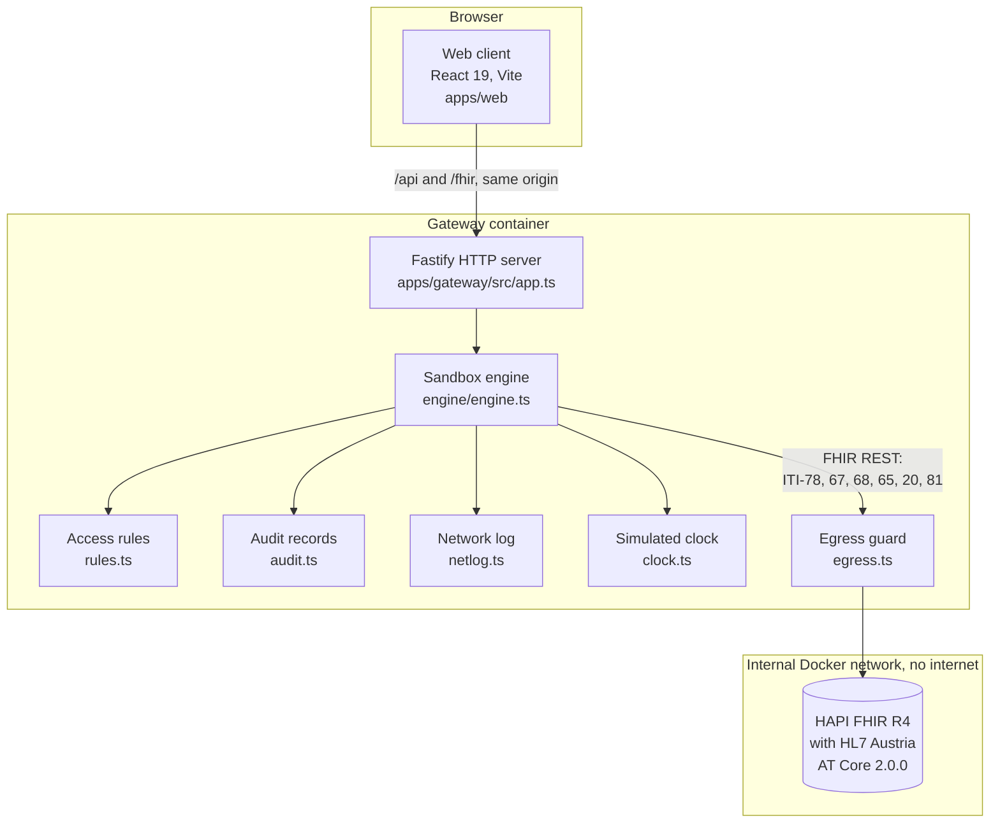
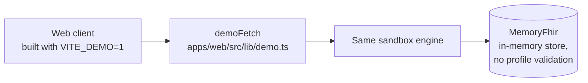

# Passayge, explained

This is a plain-language guide to what Passayge is, why it exists and how it is built. You do not need a background in healthcare or software to follow it. Technical terms are explained the first time they appear, and every term is in the [glossary](#glossary) at the end. For a longer explanation of the health IT standards mentioned here, see the [Health IT primer](HEALTH_IT_PRIMER.md).

## In one sentence

Passayge is a safe, simulated copy of the rules that decide who may open an Austrian patient's electronic health record, for how long, and how every look is logged.

## In one paragraph

Austria has a national electronic health record called ELGA. When you visit a doctor and your e-card (your social insurance card) is inserted, the doctor may open your records for a limited time, and every opening is written to a log you can read. Those rules come from a law, the Gesundheitstelematikgesetz 2012 (GTelG 2012), and they are hard to see from the outside: they live in legal paragraphs, FAQ documents and architecture papers, and the real system only works with real cards and real patients. Passayge rebuilds the rules in a sandbox, a closed practice environment, with five made-up patients. You can act as a family doctor, a specialist, a hospital or a pharmacy, insert a simulated e-card, move a simulated clock forward and watch access open, close and get logged. Every rule cites the paragraph of the law it comes from. It matters because it turns a legal text into something a developer, student or clinician can try in a browser, and it shows how the same flows could look with modern standards.

## The real-world problem

### A short story

Theresia Brandstätter is 64 and lives in Graz. (She is fictional, like everyone in Passayge.) In September she sees her family doctor, Dr. Lena Aigner, about her diabetes. Her e-card goes into the reader. In early October she has her gallbladder removed at a hospital, which writes a discharge letter. In late October she picks up a prescription at her local pharmacy.

Three questions come up, and today the answers are not obvious to anyone outside the system:

1. **Can Dr. Aigner read the hospital's discharge letter?** Yes, because she has a recent contact with Theresia. But only for a while. When does that end, exactly?
2. **Can the pharmacist read it?** No. Pharmacies may see medication only, and only for 28 days after the e-card was used there.
3. **Can a specialist Theresia has never visited read it?** No, not until Theresia's e-card is inserted at that specialist's practice.

And for each of these looks, or refusals, Theresia should later be able to see who tried, when, and what happened.

### What goes wrong

- **The rules are scattered.** The windows (90 days, 28 days, 365 days), what each kind of provider may see, opt-outs and blocks are spread across several paragraphs of GTelG 2012, an FAQ from the e-card operator and a 2017 architecture document. The [research notes](research/phase-1-research.md) list each one with its source.
- **The details matter.** Is "90 days" counted to the day or to the second? What happens one millisecond before and at the end? The law does not say; software has to decide.
- **You cannot try the real thing.** In a practice, a contact is created by the e-card system when a real card is read, and the records behind it belong to real people. There is no harmless way to experiment with it.
- **The plumbing is invisible.** ELGA uses international messaging standards (described below), but a user never sees which message is sent at which step.

Passayge addresses all four: each rule is a small function that names its source, the boundary is tested to the millisecond, the people and records are synthetic, and every message is shown in a network log next to the ELGA message it stands in for.

## The healthcare background you need

Short definitions follow. The [Health IT primer](HEALTH_IT_PRIMER.md) explains each one in more depth.

**ELGA (Elektronische Gesundheitsakte).** Austria's national electronic health record. Documents stay with the hospital or lab that wrote them; ELGA keeps an index of where they are and controls who may open them. Think of a library catalogue: it tells you which branch holds a book and whether your card lets you borrow it, but the book stays on its shelf.

**e-card and contact confirmation (Kontaktbestätigung).** The e-card is the Austrian social insurance card. When it is read in a practice, the system records a contact confirmation: proof that this patient was with this provider at this time. That proof is the key that opens the records. It is like a visitor badge with an expiry date printed on it.

**Access window.** How long after the contact the provider may open the records. Under § 18 Abs. 6 GTelG 2012 it is 90 days for doctors and hospitals and 28 days for pharmacies; the vaccination record allows 28 days for everyone (§ 24f Abs. 2). A patient can extend a trusted doctor or pharmacy to 365 days (§ 18 Abs. 7, not for hospitals), block a provider by setting their period to 0 days (§ 16), or opt out (§ 15).

**The three record types.** ELGA groups what a clinician opens into documents (e-Befunde: discharge letters, lab and imaging reports), medication (e-Medikation) and the vaccination record (e-Impfpass). Each has its own rules. Pharmacies may see medication only (§ 21 Abs. 2), and there is no opt-out from the vaccination record (§ 24e Abs. 5).

**Audit log.** A list of every access to a patient's records. § 22 Abs. 2 GTelG 2012 lists what each entry must hold: date and time, a transaction number, the type of processing, the provider, the person who acted, which data, the search criteria and any error. It is the hospital equivalent of a sign-in sheet that cannot be torn out.

**FHIR (Fast Healthcare Interoperability Resources).** A modern standard from HL7 International for exchanging health data over the web. Data is split into "resources" such as Patient, DocumentReference or AuditEvent, each a small JSON document with a fixed shape, read and written with ordinary web requests. Passayge uses FHIR R4 (release 4). Think of standard shipping containers: any port can handle them because the shape is agreed in advance.

**Profile and HL7 Austria AT Core.** A profile is a set of extra rules on top of a FHIR resource for one country or use. HL7 Austria publishes the AT Core profiles (version 2.0.0 is used here); for example, the AT Core Patient profile says a patient must have a name and a gender. It is like a national form that adds required boxes to an international one.

**IHE profiles and transactions.** IHE (Integrating the Healthcare Enterprise) publishes recipes for using standards together, and numbers each step as a transaction, for example ITI-67. ELGA is built on older IHE profiles that use SOAP web services (a heavier, XML-based style of web request). IHE also publishes FHIR versions of the same steps: PDQm to find a patient, MHD to list and fetch documents, and ATNA with BALP for audit records. Passayge uses the FHIR versions and always shows which ELGA transaction each one stands in for.

**CDA (Clinical Document Architecture).** An HL7 standard for clinical documents written in XML: a header saying who, what and when, then sections of text and coded entries. ELGA documents are CDA. Passayge's documents follow the CDA structure but are deliberately not ELGA-conformant, and say so.

**LOINC.** A catalogue of codes for lab tests and document types, so that "Discharge summary" is `18842-5` everywhere. Passayge uses LOINC codes for its document types (`packages/core/src/cda.ts`).

**SVNR (Sozialversicherungsnummer).** The 10-digit Austrian social security number: three serial digits, a check digit, and the date of birth. The check digit catches typing errors, like the last digit of an IBAN.

**HAPI FHIR.** A widely used open-source FHIR server written in Java. Passayge runs it in a container with the AT Core profiles installed, so every synthetic patient can be checked against the Austrian rules.

## What it does, step by step

Here is one full journey, as you experience it in the browser and as the data moves underneath. The default acting provider is Dr. Lena Aigner, the GP in Graz.

1. **You open Passayge.** A five-step tour explains the screen. A strip at the top says that this is an unofficial simulation. The simulated clock reads 23 October 2026, 14:05 Vienna time (`SIM_START` in `packages/core/src/seed.ts`).
2. **You search for "Brandstätter".** The browser sends `GET /fhir/Patient?family=Brandstätter` to the gateway. The gateway forwards it to HAPI FHIR as a PDQm patient search (IHE transaction ITI-78) and logs the call. In ELGA the same step would be an HL7 V3 query to the central patient index (ITI-47).
3. **You open Theresia's chart.** The browser asks `GET /api/access/pas-theresia`. The gateway runs the access rules for all three record types and answers: documents and medication granted until 24 December 2026 (90 days after Dr. Aigner's contact on 25 September), vaccination record expired (its 28-day window ended on 23 October). A banner says this in words, and a bar shows how much of each window is left.
4. **You open the documents tab.** `GET /fhir/DocumentReference?patient=...&category=documents`. Before touching HAPI, the gateway decides again. Granted, so it runs the MHD search (ITI-67), which returns the list of documents without their content, then writes an audit record (ITI-20) saying "Searched documents, 5 found, granted, within the 90-day window, § 18 Abs. 6 GTelG 2012".
5. **You open the lab report.** `GET /fhir/Binary/doc-the-lab-20260930-v2-content`. The gateway first reads the document's registry entry to learn whose it is and what type it is, decides, then fetches the content (MHD ITI-68) and writes another audit record. The browser reads the CDA-like XML, turns each lab value into a FHIR Observation and shows it with a lab result component from wardkit, with out-of-range values flagged in words.
6. **You switch to the internist, Dr. Johannes Wimmer**, who has never seen Theresia. The banner now says "No access: no contact confirmation from you for this patient." Opening documents returns `403 Forbidden`, and an audit record of the refusal is written.
7. **You press "Insert e-card".** `POST /api/contacts` records a contact confirmation at the current simulated time and writes an audit record. Access opens at once, for 90 days.
8. **You move the clock forward 90 days.** `POST /api/clock`. The banner turns to "Access expired", and the next attempt is refused with the reason "expired" and the end time.
9. **You open the audit log.** `GET /api/audit?patient=pas-theresia` runs an ATNA audit search (ITI-81). You see every search, opening, refusal and contact, newest first, including a seeded history from before the clock started. Each entry links to the network calls made for it, matched by transaction number.
10. **You change Theresia's settings as Theresia**, in a simulated access portal: for example, block a provider (0 days) or opt out of medication. The change applies to the very next request and is itself logged.

At any point, "Reset" (`POST /api/reset`) deletes the audit records written in this session, keeps the seeded history, and puts the clock and the settings back to the start.

## How it is built

In the hosted demo the same engine runs inside the browser, and an in-memory store takes HAPI's place:

### The parts

| Part | What it is | Why it exists | Talks to |
|---|---|---|---|
| **Web client** (`apps/web`) | The screens: search, patient chart with banner and access windows, records, document reader, audit and network log, help, glossary, tour. | So a person can see and try the rules. | Only the gateway, on its own origin (`apps/web/src/lib/api.ts`). |
| **Gateway** (`apps/gateway`) | A small Node.js web server. It serves the built web client and passes every `/api` and `/fhir` request to the engine. | It plays the part of ELGA's access control in front of the FHIR server, so the browser never talks to HAPI directly. | The browser on one side, HAPI on the other, through the egress guard. |
| **Sandbox engine** (`packages/core/src/engine/engine.ts`) | One class, `Engine`, with one entry point, `handle()`, that routes every request. | Keeps all the behaviour in one place so the gateway and the browser demo behave identically. | The rules, the clock, the audit writer, the network log and a `FhirClient`. |
| **Access rules** (`packages/core/src/rules.ts`) | Pure functions, mainly `decide()`, that answer "may this provider read this record type now?" with a reason and a source. | The heart of the project: the law, as code. | Nothing; the caller passes the time in. |
| **Sources** (`packages/core/src/sources.ts`) | Each legal paragraph or FAQ section, with a link to RIS (the official Austrian legal database) or the e-card FAQ. | Every decision names one, and the interface links to it. | Used by rules, audit and interface. |
| **Audit records** (`packages/core/src/audit.ts`) | `toAuditEvent()` and `fromAuditEvent()` turn one access into a FHIR AuditEvent and back. | To meet the § 22 Abs. 2 fields and store them in a standard shape. | Written to HAPI with ITI-20, read back with ITI-81. |
| **Network log** (`packages/core/src/engine/netlog.ts`) | A list of every call, with its IHE transaction, status, timing and a short excerpt. | To make the invisible plumbing visible. | Shown in the "Network" tab. |
| **Transactions table** (`packages/core/src/ihe.ts`) | For each IHE transaction: a plain explanation and the ELGA transaction it stands in for. | So every call is shown next to what ELGA would do. | Used by the network log view. |
| **Simulated clock** (`packages/core/src/engine/clock.ts`) | Starts at a fixed instant, runs at real speed, and can jump forward but never back. | So you can watch a 90-day window end in a second, while audit entries keep their order. | The engine and every FHIR client. |
| **Synthetic world** (`packages/core/src/seed.ts`, `fhir.ts`, `cda.ts`, `history.ts`) | Five patients, four acting providers, nine contacts, 18 documents, and an audit history. | Each patient shows one rule; no real data anywhere. | Loaded into HAPI or the in-memory store by `seedFhir()`. |
| **HAPI FHIR** (`infra/hapi`) | The FHIR server, image `hapiproject/hapi:v8.12.0-2`, with AT Core 2.0.0 installed from local files. | A real FHIR server and real profile validation. | Only the gateway; it sits on a Docker network marked `internal: true`. |
| **Egress guard** (`apps/gateway/src/egress.ts`) | `guardedFetch()` wraps every outbound request and throws unless it goes to the sandbox's own HAPI. | Passayge must never contact ELGA or any real service. | Wraps the HAPI client (`apps/gateway/src/hapi.ts`). |
| **In-memory FHIR store** (`packages/core/src/engine/memory-fhir.ts`) | `MemoryFhir`, enough of a FHIR server for the searches and writes the engine uses. | So the demo can run as static files on Vercel. | The engine, in the browser. |

## The technology stack

| Technology | What it does here | Why this one |
|---|---|---|
| TypeScript 6.0 | The language for all three packages. | One language and one set of types from rules to screens; the `@types/fhir` package gives typed FHIR R4 resources. |
| Node.js 22 | Runs the gateway. | Required in `package.json` (`engines`). Same language as the browser, so the engine is shared. |
| npm workspaces | Three packages in one repo: `packages/core`, `apps/gateway`, `apps/web`. | Lets the gateway and the browser import the same engine. |
| Fastify 5 | The gateway's HTTP server. | Its `inject()` method lets the gateway tests send requests without opening a network port (`apps/gateway/tests/gateway.test.ts`). A comparison with Express is not recorded in the repo: not confirmed. |
| @fastify/static | Serves the built web client from the gateway. | One origin for page and API, so the browser needs no cross-origin access. |
| HAPI FHIR, image `v8.12.0-2` | The FHIR R4 server. | `docs/architecture.md`: chosen over `v7.4.0` (used in hl7-fhir-gateway) for the newer validator. |
| HL7 Austria FHIR Core `hl7.at.fhir.core.r4` 2.0.0, with `hl7.terminology.r4` 6.2.0 and `hl7.fhir.uv.extensions.r4` 5.1.0 | The Austrian profiles HAPI validates against. | The national base profiles; downloaded at image build time and checked by SHA-256 hash (`infra/hapi/Dockerfile`). |
| Docker and Docker Compose | Runs HAPI and the gateway, with HAPI on an internal network. | One command (`docker compose up --build`) for the full stack, and network isolation by configuration. |
| React 19.3.1 | The web client. | Not recorded in the repo: not confirmed. |
| Vite 8 | Builds and serves the web client in development. | Its build flag `VITE_DEMO=1` switches the client into demo mode (`apps/web/src/lib/mode.ts`). |
| Tailwind CSS 4, clsx, tailwind-merge | Styling. | Not recorded in the repo: not confirmed. |
| lucide-react | Icons. | Self-hosted with the app, so no request goes to an icon CDN. |
| Atkinson Hyperlegible Next and Mono, Passayge Text | Fonts, self-hosted. | Designed for legibility; Passayge Text is a modified copy with an unslashed zero (`scripts/fonts/plainzero.py`). |
| wardkit `LabResult` | Shows lab values with reference ranges and flags. | Copied unchanged from the author's own wardkit library (`apps/web/src/components/wardkit/SOURCE.md`). |
| esbuild | Bundles the gateway into one file for the container. | Small runtime image: the container ships only `server.mjs` and the built client. |
| tsx | Runs TypeScript directly for development and the validation script. | No separate build step for scripts. |
| Vitest 5 | Unit and integration tests. | One runner for all three packages, with a separate "integration" project that needs HAPI. |
| Testing Library, jsdom, axe-core | Client tests and accessibility checks without a real browser. | axe checks against WCAG rules. |
| Playwright 1.64 with @axe-core/playwright | Browser tests in Chromium, with axe in light and dark mode. | Also watches every network request the page makes. |
| ESLint 9 with typescript-eslint | Code checks. | Run in CI. |
| GitHub Actions | CI with four jobs (see below). | Runs on every push and pull request. |
| Vercel | Hosts the static demo with a strict Content Security Policy (`vercel.json`). | The demo needs no server. |
| GitHub Codespaces | One-click full stack in the cloud (`.devcontainer/devcontainer.json`). | Lets a reviewer run Docker without installing it. |

## The hard parts and how they were solved

### 1. The exact end of an access window

**Problem.** The law says the identity check must "not lie further back than" 90 days. Does access end at midnight, after 90 calendar days, or after 90 times 24 hours? And is the last instant still inside? Off-by-one errors here mean a doctor sees records they should not, or is refused records they need.

**Solution.** The sandbox chooses one reading, states it, and tests it. A window of N days ends exactly N x 24 hours after the contact timestamp, and access at that instant is refused (`now >= until` means expired). The reading is labelled in the interface and the README as the sandbox's assumption. The order of checks is fixed: first what this provider type may see, then opt-out, then whether there is a contact at all (contacts older than 365 days count as gone), then a block (0 days), then the window. So each refusal gets the most useful reason, matching the distinct error reasons the e-card FAQ describes. The simulated clock can only move forward, so time travel cannot create impossible audit histories.

**Where.** `decide()` and `windowDays()` in `packages/core/src/rules.ts`; `SimClock` in `packages/core/src/engine/clock.ts`. Tested in `packages/core/tests/rules.test.ts` ("grants a doctor documents one millisecond before 90 days and expires them at exactly 90 days") and over HTTP in `apps/gateway/tests/gateway.test.ts` ("the expiry boundary, exactly": 24 December 2026, 08:40:03 UTC, minus one millisecond is granted, the exact instant is refused).

### 2. One engine, two very different back ends

**Problem.** The full stack needs Docker and a Java FHIR server that takes over a minute to start. A hosted demo must run as static files. Two separate implementations would drift apart, and then the demo would teach different rules from the real stack.

**Solution.** All behaviour lives in one `Engine` class that knows nothing about HTTP. It talks to storage through a small `FhirClient` interface with one method, `call()`. The gateway implements it over HTTP against HAPI (`Hapi`), and the browser implements it with an in-memory store (`MemoryFhir`). The demo build replaces `fetch` with `demoFetch`, which hands the same paths to the same engine. CI runs the same 17 browser tests against both the Docker stack and the demo build.

**Where.** `packages/core/src/engine/engine.ts` (`Engine.handle()`), `packages/core/src/engine/fhir-client.ts`, `apps/gateway/src/hapi.ts`, `packages/core/src/engine/memory-fhir.ts`, `apps/web/src/lib/demo.ts`; CI jobs `browser` and `demo` in `.github/workflows/ci.yml`.

### 3. An audit record for every access, that survives a reset

**Problem.** Every search, opening, refusal, contact and settings change must produce an audit entry with the fields § 22 Abs. 2 lists, stored in a standard format and readable back. The log must be current the instant after an action, yet "Reset" must clear a visitor's session without erasing the seeded history.

**Solution.** `toAuditEvent()` maps each record into a FHIR AuditEvent: the person and organisation as agents, the patient and the data as entities, and the remaining fields (outcome, reason, legal source, transaction number) as entity details. `fromAuditEvent()` reverses it, and a test checks the round trip keeps every required field. Calls made for one user action share a transaction number, which links each audit entry to its network calls. Session entries carry a `session` tag; reset deletes by that tag, so history entries (written without it) stay. HAPI normally reuses search results for 60 seconds, which would hide new entries; the sandbox turns that off on the server (`reuse_cached_search_results_millis: 0` in `infra/hapi/application.yaml`) and sends `cache-control: no-cache` on every call (`apps/gateway/src/hapi.ts`).

**Where.** `packages/core/src/audit.ts`, `writeAudit()` and `audit()` in `engine.ts`, `clearSessionAudit()` in `packages/core/src/engine/seed-fhir.ts`. Tests in `packages/core/tests/data.test.ts` ("keeps every required field through a FHIR AuditEvent round trip") and `apps/gateway/tests/hapi.integration.test.ts` ("reset deletes session audit events from HAPI and keeps the history").

### 4. Nothing leaves the sandbox

**Problem.** A sandbox about ELGA must never contact ELGA, the e-card system or anything else, and must never send personal data, even by accident.

**Solution.** Several layers, each tested. HAPI sits on a Docker network marked `internal: true`, with no route to the internet and no published port. Its profile packages are downloaded when the image is built, checked against fixed SHA-256 hashes, and installed from local files, so the running server never fetches anything. In the gateway, every outbound request goes through `guardedFetch()`, which throws `EgressBlockedError` before a connection is opened unless the target is the sandbox HAPI. The browser only talks to its own origin; fonts and icons are self-hosted, and the demo's Content Security Policy allows only `'self'`. A script checks the repository and all request code for the maintainer's email address (by hash, so the script does not contain it) and checks every User-Agent string.

**Where.** `docker-compose.yml`, `infra/hapi/Dockerfile`, `apps/gateway/src/egress.ts`, `scripts/check-personal-data.mjs`, `vercel.json`. Tests: "no request leaves the sandbox" in `apps/gateway/tests/gateway.test.ts` and in `apps/web/e2e/a11y-and-egress.spec.ts`, which records every request a full browser session makes and fails on any other origin or any email-like string.

### 5. Synthetic people who pass validation but can never be real

**Problem.** To be convincing, test patients need social security numbers with a correct check digit and records that pass the Austrian profile. But a valid-looking number could belong to a real person.

**Solution.** The SVNR check digit is computed exactly as the Federal Ministry describes it (weights 3 7 9 5 8 4 2 1 6, modulo 11, skipping a serial whose check digit would be 10). The ministry also says real serial numbers start at 100, so Passayge only creates serials 000 to 099: valid format, outside the issued range. The numbers are stored under a Passayge identifier system, never the real SVNR identifier, and every resource carries a `synthetic` tag. Addresses use real postcodes with fictional street names. Every patient is then validated by HAPI against the AT Core Patient profile.

**Where.** `syntheticSvnr()`, `checkDigit()` and `isSyntheticSvnr()` in `packages/core/src/svnr.ts`; `patientResource()` in `packages/core/src/fhir.ts`; tests in `packages/core/tests/data.test.ts` ("only ever creates serials below 100, which are never issued", "never uses the real SVNR identifier system") and `apps/gateway/tests/hapi.integration.test.ts` ("validates every synthetic patient against AT Core without errors").

## How we know it works

Counts below are from running every suite locally on 23 October 2026. All passed, with one exception: on the Docker stack one browser test (keyboard navigation through the audit log) timed out once locally, while all 17 passed against the demo build; the same suite passed in CI on the latest commit. The test itself carries a comment that it once raced under load.

| Suite | Command | Tests | What it proves |
|---|---|---|---|
| Access rules, data and engine | `npm test -w @passayge/core` | 41 | Every rule at and around its boundary; SVNR check digits and the synthetic range; CDA output; the audit round trip; the seeded history; the glossary; the engine end to end with the in-memory store. |
| Gateway | `npm test -w @passayge/gateway` | 27 | Every rule over HTTP against a fake FHIR server; every IHE transaction; the audit record for each case; the exact expiry boundary; egress blocking. |
| Gateway with HAPI FHIR | `npm run test:integration` | 7 | AT Core is installed; every synthetic patient validates; a patient without name and gender is rejected; ITI-78, ITI-67, ITI-68, ITI-20 and ITI-81 end to end against a real HAPI server; reset. |
| FHIR validation | `npm run validate:fhir` | 53 resources | Every resource the sandbox writes, sent to HAPI's `$validate`. Fails on any error, reports warnings. Result: 0 errors, 10 warnings. |
| Web client | `npm test -w @passayge/web` | 24 | Tooltips (keyboard, hover, tap), the tour, the glossary, the banner sentence, reading CDA, axe accessibility checks in jsdom. |
| Browser | `npm run test:e2e` | 17 | The tour; denied, then e-card, then granted, both logged; pharmacy limited to medication; the clock ending a window; keyboard shortcuts; axe on every page in light and dark at desktop and tablet size; no request leaving the sandbox. |

That is 92 unit tests, 7 integration tests and 17 browser tests.

**Continuous integration** (`.github/workflows/ci.yml`) runs four jobs on every push and pull request:

1. **check**: typecheck, lint, the personal-data check, a check that no em dash character is in any file, the 92 unit tests, and a production build.
2. **integration**: starts HAPI with AT Core in Docker, runs the integration tests, then validates every resource.
3. **browser**: starts the full stack with `docker compose up` and runs the browser tests against it.
4. **demo**: builds the static demo exactly as Vercel does and runs the same browser tests against it.

**Validation against an official tool.** The AT Core profiles are the official HL7 Austria package, and the validator is HAPI FHIR's built-in `$validate` operation. In the run above, all 10 warnings were on the five patients, two each: the ELGA patient identifier value set (`https://termgit.elga.gv.at/ValueSet/hl7-at-patientidentifier`) is not available offline, and the identifier type coding is not one HAPI finds in the base FHIR identifier type value set. Warnings are reported and accepted by design; errors fail the build (`apps/gateway/scripts/validate-fhir.ts`).

## What is deliberately simplified or left out

| Simplification | Why |
|---|---|
| Inserting the e-card is a button. No card reader, no e-card system, no signed contact. | The point is the rules, not the card hardware, and the real e-card system cannot be used for experiments. |
| One sandbox service stands in for three ELGA services: the contact confirmation service, the token service and the policy store. It issues no SAML assertions (the signed XML security tokens ELGA uses). | The decision logic is what matters for learning; the token exchange would add a lot of machinery without changing the outcome. |
| One ELGA area, so no queries across areas. | ELGA has several areas (regional or organisational zones, each with its own index); cross-area queries are named in the network log but not run. |
| FHIR instead of ELGA's SOAP transactions. | To show how the same flows look with the IHE FHIR profiles. The real ELGA transaction is shown next to every call. |
| Documents are CDA-like XML, not checked against ELGA's implementation guides. | Building conformant ELGA documents is a project of its own. Each document says it is not ELGA-conformant (`packages/core/src/cda.ts`). |
| Access is shown before you try. | Teaching aid. ELGA has no such query; real software finds out by trying. |
| N days means exactly N x 24 hours. | The law does not say; see hard part 1. |
| Time is simulated and can jump ahead. | So windows can be watched ending. |
| Not modelled: hospital access for the whole inpatient stay, with the window starting at discharge. | The only source found is the 2017 architecture document, written under an older 28-day rule. |
| Not modelled: dentists, care facilities, ambulance services and the 1450 health line as acting providers; contactless e-authorisation through the social insurance apps. | Out of scope for the first version; the e-authorisation is listed as planned. |
| Demo mode has no AT Core validation and resets on reload. | It runs in the browser without HAPI. The interface says so in a strip at the top of every page. |

Also worth knowing:

- The rule for an objection to storing one treatment case (`decideStore()` in `rules.ts`) is implemented and tested, and the objection is recorded with the contact, but the sandbox has no step in a session that stores a new document, so no running flow calls it.
- The audit records are validated against the base FHIR R4 AuditEvent, not against IHE's BALP audit profile. Whether they fully conform to BALP is not confirmed.

## Glossary

**Access portal.** The website where Austrian patients see their ELGA log and change their settings. Simulated in Passayge as a panel labelled "Access portal, simulated".

**Access window.** How long after a contact confirmation a provider may open a patient's records: 90, 28 or up to 365 days depending on provider and record type.

**Affinity domain.** IHE's term for a group of systems that share one document registry and patient index. ELGA's areas are affinity domains.

**ATNA (Audit Trail and Node Authentication).** The IHE profile for audit logs. ITI-20 records an audit event; ITI-81 searches audit events in FHIR.

**AuditEvent.** The FHIR resource for one audit log entry: who did what to which data, when, and with what outcome.

**axe.** An automated accessibility checker that tests a page against the WCAG guidelines.

**BALP (Basic Audit Log Patterns).** An IHE profile that describes how to fill in FHIR AuditEvents for common actions.

**Binary.** The FHIR resource that holds raw content, here the XML of a document.

**Blocked provider.** A provider whose access period the patient set to 0 days. The contact exists but opens nothing.

**Bundle.** A FHIR resource that carries several resources together. A "transaction" Bundle asks the server to store all of them at once.

**CDA (Clinical Document Architecture).** HL7's XML standard for clinical documents, used by ELGA.

**CI (continuous integration).** Automated checks that run on every change to the code, here on GitHub Actions.

**Codespaces.** GitHub's cloud development environments, which can run the full Passayge stack from a button.

**Contact confirmation (Kontaktbestätigung).** The record that a patient was with a provider at a certain time, created when the e-card is read. It opens the access window.

**Container.** A packaged, isolated program with everything it needs, run by Docker.

**Content Security Policy (CSP).** A browser rule set sent by a website that says where the page may load scripts, styles and data from.

**Demo mode.** The static build of Passayge where the engine runs in the browser with an in-memory store instead of HAPI.

**Docker, Docker Compose.** Docker runs containers; Compose starts several containers together from one file.

**DocumentReference.** The FHIR resource that describes a document (type, date, author, patient) and points to its content.

**e-Befunde.** The documents part of ELGA: discharge letters, lab and imaging reports.

**e-card.** The Austrian social insurance card.

**e-Impfpass.** The electronic vaccination record. 28 days for every provider, no opt-out.

**e-Medikation.** The medication part of ELGA: prescribed and dispensed medicines.

**Egress.** Network traffic leaving a system. Passayge allows egress only to its own FHIR server.

**ELGA (Elektronische Gesundheitsakte).** Austria's national electronic health record.

**ELGA area (ELGA-Bereich).** One of the regional or organisational zones of ELGA, each with its own registry, repositories and audit log.

**Endpoint.** One address on a server that answers a type of request, for example `/api/contacts`.

**Engine.** In Passayge, the `Engine` class that handles every request the same way for the gateway and the demo.

**Expiry boundary.** The exact instant an access window ends; access at that instant is refused.

**FHIR (Fast Healthcare Interoperability Resources).** HL7's web standard for health data, made of resources exchanged over REST.

**FHIR R4.** Release 4 of FHIR (version 4.0.1), the release AT Core and HAPI use here.

**Gateway.** The Passayge server that sits between the browser and the FHIR server and applies the access rules.

**GTelG 2012 (Gesundheitstelematikgesetz 2012).** The Austrian law that governs ELGA, including access windows, opt-out and logging.

**HAPI FHIR.** An open-source FHIR server in Java.

**HL7 (Health Level Seven International).** The standards organisation behind FHIR, CDA and HL7 v2.

**HL7 Austria AT Core.** The Austrian base FHIR profiles published by HL7 Austria; version 2.0.0 here.

**Identifier system.** A web address that says which numbering scheme an identifier belongs to, so that "1234" from one scheme is not confused with another.

**IHE (Integrating the Healthcare Enterprise).** An organisation that publishes profiles: recipes for combining standards for one task.

**Implementation guide.** A published set of FHIR profiles and rules for one country or use case.

**ITI-nn.** The number of an IHE transaction in its IT Infrastructure domain, for example ITI-67 Find Document References.

**JSON.** A simple text format for structured data, used by FHIR.

**LOINC.** A catalogue of codes for lab tests and clinical document types.

**MHD (Mobile access to Health Documents).** The IHE FHIR profile for listing (ITI-67), fetching (ITI-68) and storing (ITI-65) documents.

**Mermaid.** A text format for diagrams that GitHub draws as pictures.

**Network log.** Passayge's list of every call it makes, with the IHE transaction and the ELGA transaction it stands in for.

**Objection for one treatment case.** The patient asks that nothing from this visit is stored in ELGA (§ 16 Abs. 2 Z 2).

**Observation.** The FHIR resource for one measurement, such as a lab value.

**Opt-out (Widerspruch).** The patient leaves ELGA fully or for documents or medication (§ 15). Not possible for the vaccination record.

**PDQm (Patient Demographics Query for Mobile).** The IHE FHIR profile for finding a patient by name, birth date or identifier (ITI-78).

**Profile.** A set of extra FHIR rules for one country or use, such as AT Core Patient.

**Provider of special trust.** A doctor or pharmacy the patient allows up to 365 days of access. Not possible for hospitals.

**Resource.** One unit of FHIR data, such as Patient or AuditEvent.

**REST.** A style of web interface where you read and write data with standard web requests (GET, POST, PUT, DELETE) on addresses.

**RIS (Rechtsinformationssystem des Bundes).** The official Austrian federal legal database, where GTelG 2012 is published.

**Sandbox.** A closed environment for safe experiments, with no effect on real systems.

**SAML assertion.** A signed XML token that says who a user is and what they may do. ELGA's token service issues them; Passayge does not.

**Simulated clock.** Passayge's own time, which starts on 23 October 2026 and can jump forward.

**SOAP.** An older, XML-based style of web service, used by ELGA's IHE transactions.

**SVNR (Sozialversicherungsnummer).** The Austrian 10-digit social security number with a check digit.

**Synthetic data.** Made-up data that looks real but belongs to no one.

**Transaction number.** An identifier for one user action, shared by its audit entry and its network calls.

**Validation.** Checking a resource against the rules of FHIR and a profile, here with HAPI's `$validate`.

**WCAG.** The Web Content Accessibility Guidelines, the international standard for accessible websites.
